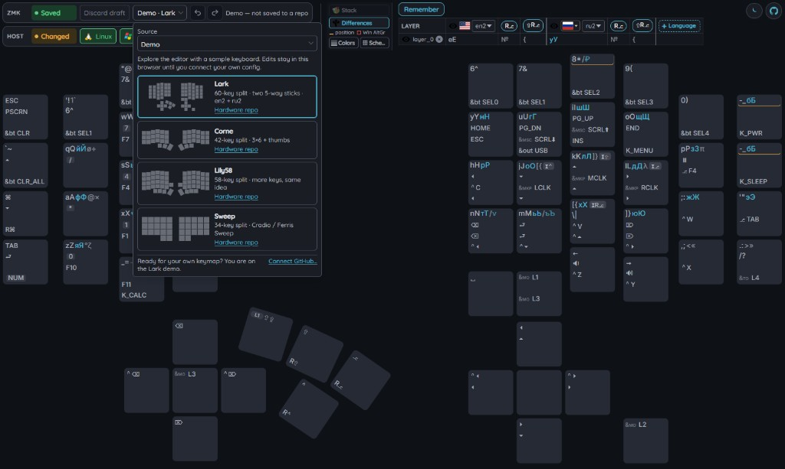
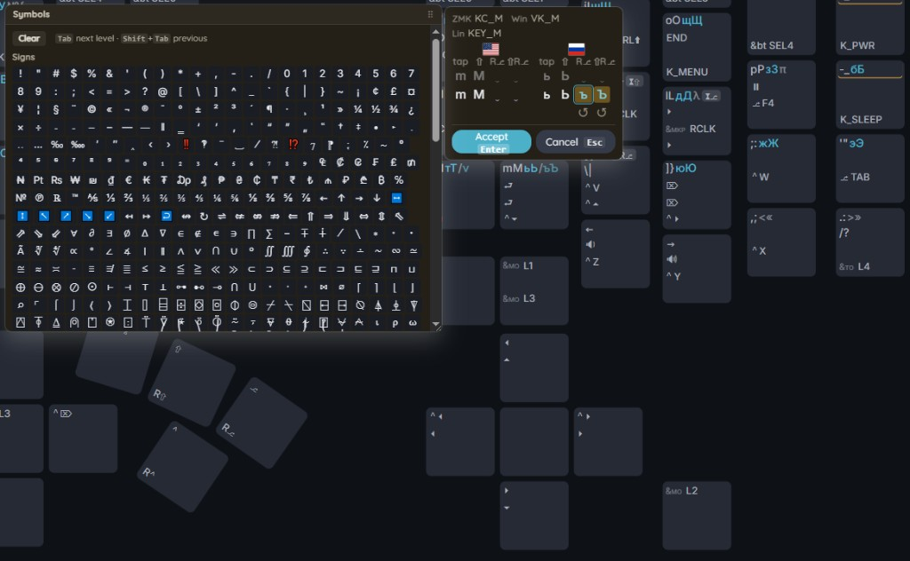
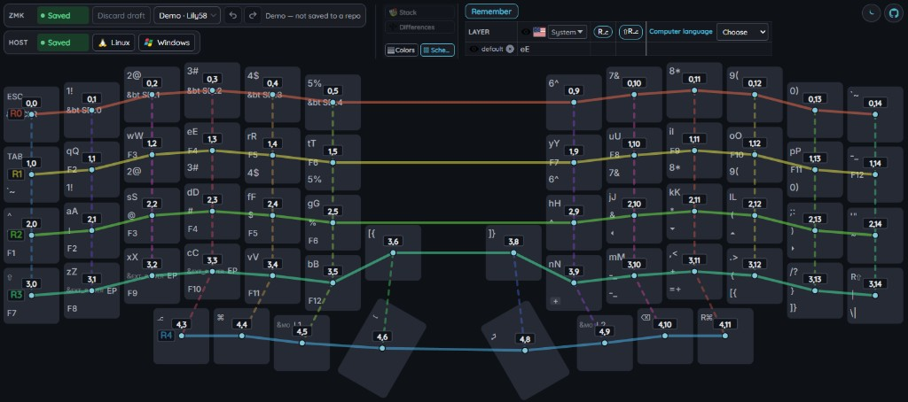
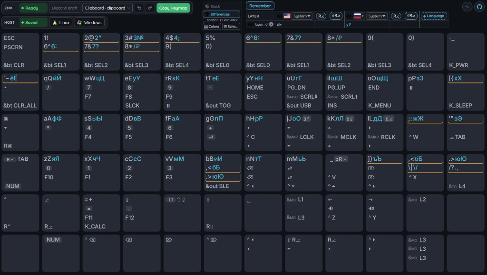

#  ZMK Keymap Editor Extended

**A browser editor for ZMK keymaps that also shows what the selected host OS layout will type.**

## Use the live editor

**[Open zmkee.forgegod.workers.dev](https://zmkee.forgegod.workers.dev/)**

This is this fork's live, same-origin SPA and API deployment. It supports:

- **Demo** keyboards with no account;
- **Clipboard** import and export of a `.keymap` with optional layout JSON;
- **GitHub** loading and commits through the [zmkee GitHub App](https://github.com/apps/zmkee) after OAuth login and App installation on the target repository; and
- capability-gated browser **Filesystem** access for one existing raw `.keymap`.

The hosted service runs the Svelte editor and Hono API on Cloudflare. GitHub OAuth tokens remain on the server; the browser receives only an HttpOnly session cookie. The [health endpoint](https://zmkee.forgegod.workers.dev/health) is public, but repository loading and commits require sign-in and authorization.

There is also a static [GitHub Pages testing build](https://forgegod.github.io/katafoxi-keymap-editor-extended/). It is useful for Demo, Clipboard, and supported browser Filesystem workflows, but it cannot provide GitHub login, repository commits, or the development-only Local adapter.

## What this editor is for

ZMK tells the keyboard what keycodes or behaviors to send. The host OS layout determines the resulting characters. This editor keeps those two concerns visible together:

1. Edit the ZMK binding that the firmware sends.
2. See composed keycap legends for the selected host-language layouts and modifier levels.
3. Use **Alt+click** to edit a host-layout glyph; ordinary click remains a ZMK-binding edit.
4. Export, copy, save, or commit the firmware through the chosen source boundary.

For example, one keycap can show firmware output and composed English/Russian glyphs such as `qQ` and `йЙ`, rather than making a user mentally translate one from the other.



## Fork lineage and credits

This project respectfully builds on two open-source projects:

- [nickcoutsos/keymap-editor](https://github.com/nickcoutsos/keymap-editor) — the original ZMK keymap editor and the source of the upstream project.
- [katafoxi/keymap-editor-extended](https://github.com/katafoxi/keymap-editor-extended) — the intermediate extended fork that introduced the host-layout direction and its separate deployment at [zmk-keymap-editor.com](https://zmk-keymap-editor.com/).

This repository, [forgegod/katafoxi-keymap-editor-extended](https://github.com/forgegod/katafoxi-keymap-editor-extended), diverged from that line and contains its own implementation, tests, deployment adapter, and documentation. The live implementation for this repository is **[zmkee.forgegod.workers.dev](https://zmkee.forgegod.workers.dev/)**. Upstream and intermediate deployments are separate services and do not necessarily contain this fork's changes.

The code is MIT licensed. ZMK keycode data is derived from ZMK documentation, also MIT licensed.

## What this fork adds and extends

The list below describes implemented behavior in this checkout. It does not claim every feature of either upstream project, every ZMK behavior, or every operating-system layout format.

### Host layouts and composed legends

- Composed keycap faces with four modifier-level slots per displayed language and up to two languages on a keycap.
- System and user host-layout profiles, persistent language selection, remembered legend assemblies, and language-stack/difference views.
- Read-only hover decode; **Alt+click** begins an explicit host-edit session. Editing a system layout first creates a user copy.
- Host glyph editing independent from ZMK undo/redo, with explicit Accept/Cancel session controls.
- Import of supported xkb/KLC layouts and downloadable Linux xkb and Windows `.klc` deliverables from the Host lane.
- GitHub commits can co-commit a compatible, owned host-layout snapshot and generated host deliverables with the firmware. The server rejects invalid, unsupported, ambiguous, or unowned host output instead of publishing browser state it cannot prove.
- Clear source boundaries: browser Filesystem saves never write host snapshots or installation files; browser-only host work stays browser-local until a compatible GitHub commit.



### Firmware editing beyond a basic key grid

- Staged key editor for ZMK bindings, keys, modifiers, layer references, mouse/device commands, output selection, and supported stock behaviors.
- Source-preserving import/edit/export: known edits splice into existing DTS where proven safe, while external and opaque bindings/arguments are retained rather than silently normalized.
- Layers: add, rename, delete, duplicate, reorder, keyboard-accessible move controls, drag/drop parity, and undo/redo-aware reference remapping where the source model proves it is safe.
- Visual **combos**, including bindings, positions, timeouts, layer filters, slow release, prior idle time, and chord-oriented board/dictionary views.
- Conditional-layer rules and per-layer encoder `sensor-bindings` with directional editing.
- Hold-tap timing, Homerow/Autoshift presets, the fixed `&rgblayer` recipe, and compact firmware legends.
- Bounded visual authoring for supported macros and custom behavior definitions on Demo and verified Clipboard sources, including source preview and confirmation before rewriting. Unsupported or unproven definitions remain read-only and source-preserved.
- `&uc` Unicode picker with curated aliases and input-mode choices; existing aliases and opaque bindings survive round trips. Firmware module/configuration and host input setup remain the user's responsibility.
- Recognition of current ZMK behaviors such as `&sys_reset` and `&studio_unlock`, while retaining legacy imported `&reset` without converting it.



### Safer source, draft, and persistence workflows

| Source | What it does | Important boundary |
| --- | --- | --- |
| **Demo** | Loads bundled sample keyboards and supports in-browser exploration. | No firmware publication. |
| **Clipboard** | Imports `.keymap` text, optionally with layout JSON; **Copy .keymap** writes the generated source to the system clipboard. | Manual transfer back to a firmware repository. |
| **Filesystem** | Opens one existing raw `.keymap`, or discovers direct entries in a chosen folder. | Every Save requires fresh same-file picker proof and writes firmware only — no sidecars, layouts, host files, or multi-file save. |
| **GitHub** | Loads an authorized `zmk-config`, lets the user choose an eligible keymap file, and commits against a pinned base SHA. | Stale heads reject the commit instead of overwriting newer remote work. |
| **Local** | Development adapter for a configured sibling `zmk-config`. | Not the browser Filesystem source and not the product's long-term persistence path. |

Additional workflow improvements:

- Browser draft/cache recovery, native leave-page protection for unpublished firmware or protected GitHub recovery, and explicit discard/reconcile paths.
- Exact GitHub repository/branch/keymap-file identity, remembered selections, explicit missing/ambiguous file states, and path-specific layout errors.
- Optional offline layout discovery for Clipboard/GitHub: import a reviewed catalog, inspect provenance and a preview, then explicitly adopt session-only geometry or download validated JSON. The editor does not fetch arbitrary includes or guess hardware from a filename.
- Editable rectangular fallback when a usable physical layout is absent; it reflects binding count, not real keyboard geometry.
- Source-preserving firmware commits and guarded host-snapshot co-commit rules shared by the API and browser.



### Product and runtime work in this repository

- Svelte 5 + Vite SPA, thin Hono API, and shared TypeScript domain package (`packages/keymap-core`) for parsing, serialization, layout composition, and host-format generation.
- Cloudflare Worker/container adapter that hosts the same SPA/API deployment without relying on a local computer at runtime.
- Demo catalog with Corne, Glove80, Kabarga, Kyria, Lark, Lily58, nice!60, Planck, PNCATEHO, Sofle, Sweep, and other fixture-backed layouts.
- Light and dark themes, an editor tour, Scheme coordinates, keyboard/source status chrome, and explicit ZMK-versus-Host lanes.
- Unit, component, API, Cloudflare, record-validation, and Playwright browser coverage for the implemented boundaries.

## Deliberate limits

- This is not a firmware compiler, flasher, general DTS/C-preprocessor editor, or OS-layout installer.
- Macro and behavior authoring intentionally supports a bounded, validated subset. It does not turn opaque source, remote repositories, or arbitrary ZMK definitions into safe editable syntax.
- Host-layout imports/exports support documented xkb/KLC subsets, not every feature of those formats.
- Physical geometry is accepted only from supplied metadata or an explicit reviewed catalog choice. A fallback rectangle is not a hardware claim.
- Browser storage and recovery are not publication. Review generated firmware diffs and build/flash through your normal ZMK workflow.

The precise behavior and test evidence live in the [capability index](docs/product/index.md), not in this overview. Pending work belongs in [change records](docs/changes/README.md), not in the feature list above.

## Run locally

Use Node 24.21.0 (pinned in `.nvmrc`) and pnpm 9.15.0.

```bash
pnpm install
pnpm dev
```

The local SPA runs at `http://127.0.0.1:5173`; the API runs at `http://127.0.0.1:8080`.

For environment setup, the development Local adapter, GitHub App configuration, and source-specific workflows, see [running-locally.md](running-locally.md). For managed deployment, see [Cloudflare Containers](docs/deploy-cloudflare.md); for a VPS deployment, see [VPS deployment](docs/deploy-vps.md).

## Development checks

```bash
pnpm test            # Workspace tests plus product-record validation
pnpm lint            # TypeScript and Svelte checks
pnpm build           # keymap-core, SPA, and Hono API
pnpm test:e2e        # Playwright browser smoke tests
pnpm test:e2e:prod   # Production SPA/API smoke tests
pnpm test:e2e:pages  # Static Pages workflow smoke tests
```

The product documentation uses CAP records for implemented behavior and CHG records for material work in progress. Regenerate and inspect canonical product schematics when changing a human-facing capability:

```bash
pnpm wireframes:generate
pnpm wireframes:render
pnpm records:check
```

## Documentation map

| Document | Purpose |
| --- | --- |
| [running-locally.md](running-locally.md) | Local setup, source workflows, and tests |
| [docs/architecture.md](docs/architecture.md) | Current runtime, persistence, and security boundaries |
| [docs/TARGET_SYSTEM.md](docs/TARGET_SYSTEM.md) | Product vision and editor contracts |
| [docs/product/index.md](docs/product/index.md) | Implemented capabilities and executable evidence |
| [docs/changes/README.md](docs/changes/README.md) | Change-record lifecycle and remaining requests |
| [docs/adr/README.md](docs/adr/README.md) | Architecture decision records |
| [docs/deploy-cloudflare.md](docs/deploy-cloudflare.md) | Cloudflare deployment and operational constraints |
| [AGENTS.md](AGENTS.md) | Repository ownership and contribution contracts |